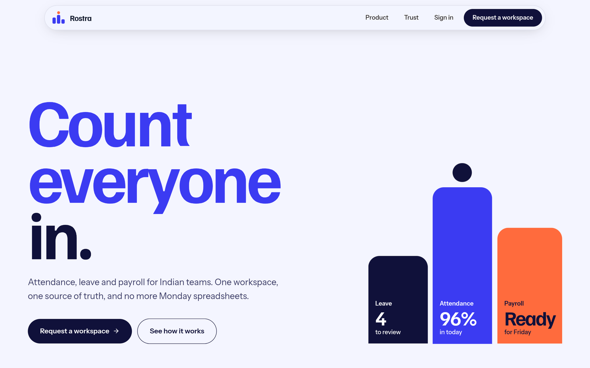
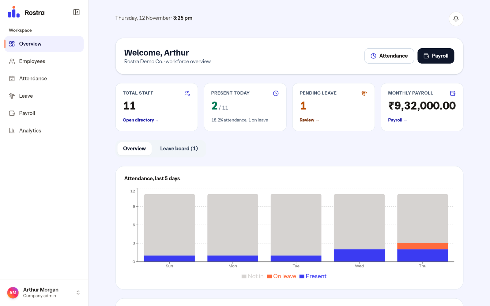
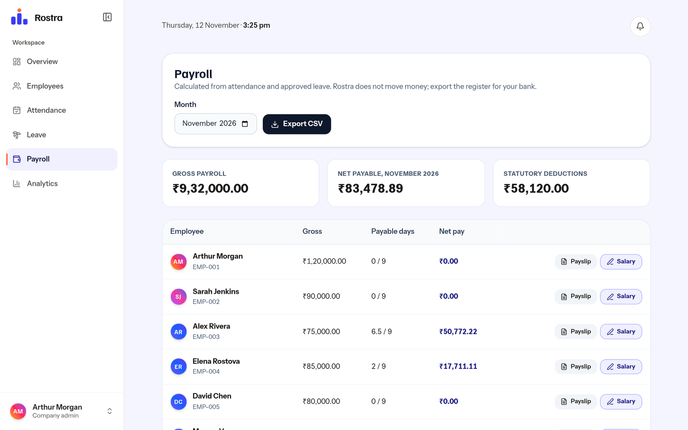
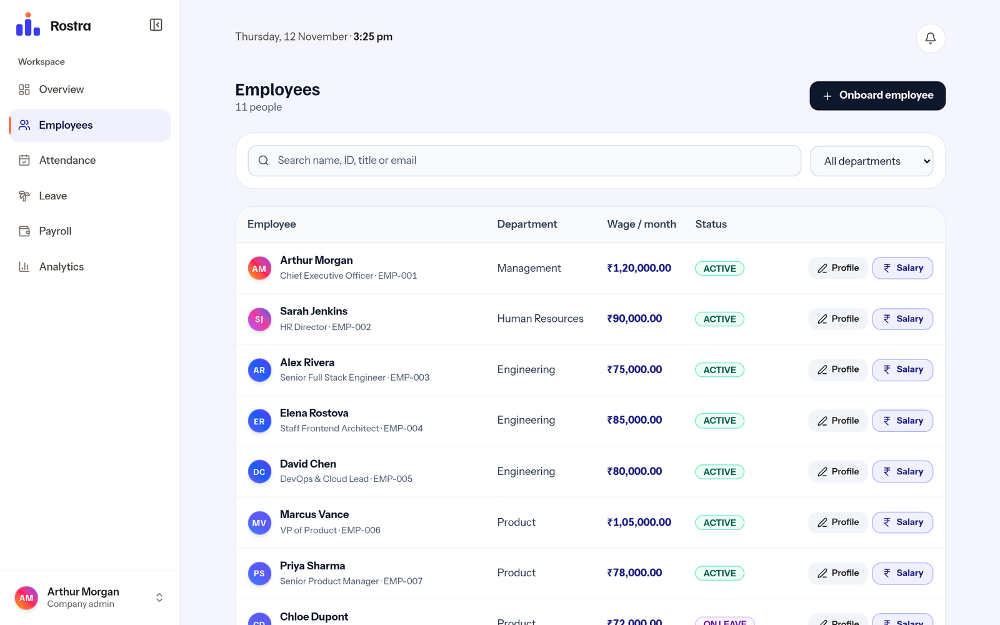
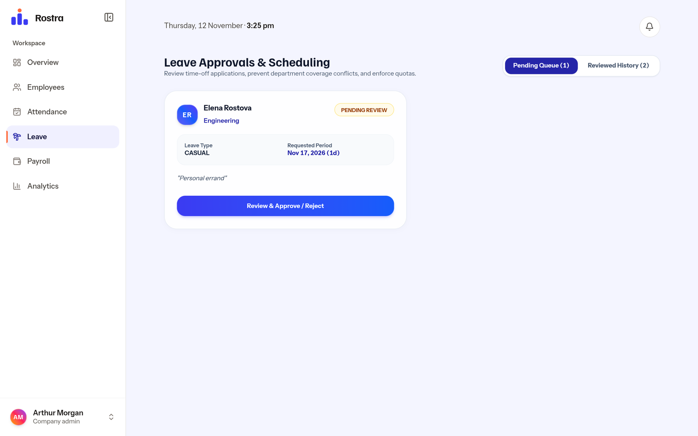
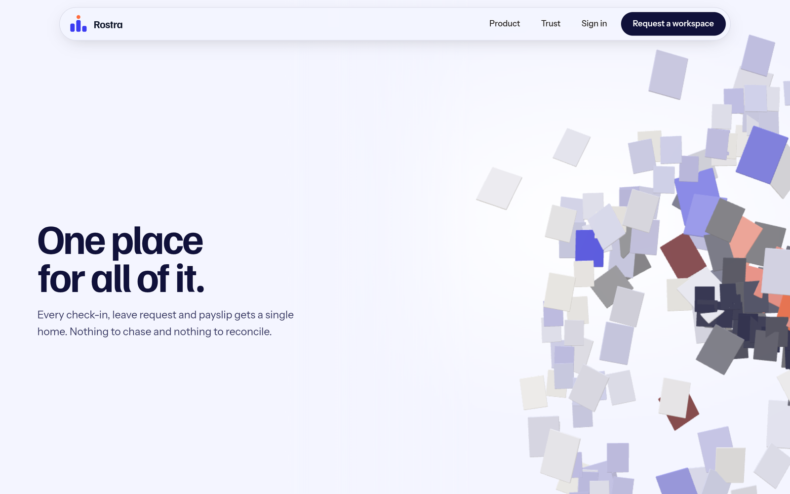
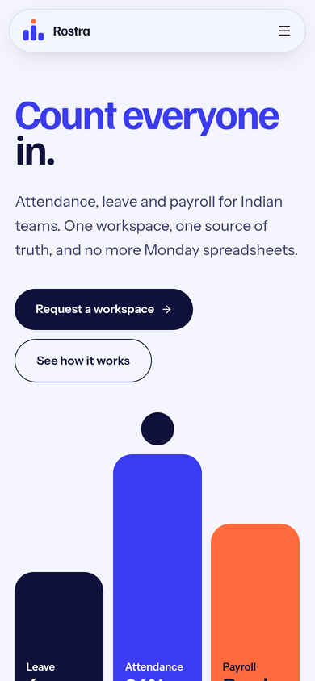
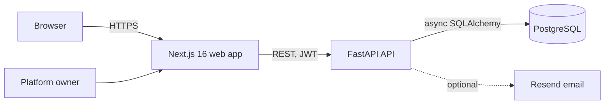

<p align="center">
  
</p>

<h1 align="center">Rostra</h1>

<p align="center">
  <strong>Attendance, leave and payroll for Indian teams, in one workspace.</strong><br/>
  A multi-tenant HR platform: every company gets its own sealed workspace, and HR stops chasing spreadsheets.
</p>

<p align="center">
  <a href="https://github.com/Harsha-code-per/rostra/actions/workflows/ci.yml"></a>
  
  
  
  
</p>

<p align="center">
  
</p>

---

## Why Rostra

Every HR team has the same Monday: a sheet for attendance, a chat thread for leave, a calculator for payroll. The three never agree, and the month-end close is a scramble.

Rostra puts all three on one record. A check-in, an approved leave day and a payslip all come from the same data, so there is nothing to reconcile.

- **Built for Indian payroll first.** Basic, HRA, Provident Fund and Professional Tax are calculated from the wage and the days actually worked.
- **Multi-tenant from day one.** Companies are isolated workspaces with their own admins, HR staff and employees. A platform console provisions and suspends them.
- **Honest about what it does.** Rostra calculates payroll and exports it. It does not move money.

## What it does

| For | Capabilities |
|---|---|
| **Employees** | One-tap check-in and out with a live timer, attendance history and monthly summary, leave balances and requests, payslips by month with PDF download, profile and emergency contact |
| **HR and admins** | Company attendance board for any date with manual corrections for missed check-ins, leave approvals (a request can be decided exactly once), employee directory and onboarding with one-time passwords, salary structure editor, payroll register with CSV export, analytics |
| **Platform owner** | Create customer workspaces with a plan and employee limit, suspend or reactivate a workspace (everyone in it is locked out immediately), triage website inquiries |

## Screenshots

<table>
  <tr>
    <td width="50%"><br/><sub><b>Overview.</b> Live headcount, attendance and the leave queue.</sub></td>
    <td width="50%"><br/><sub><b>Payroll.</b> Per-month register from attendance and approved leave.</sub></td>
  </tr>
  <tr>
    <td width="50%"><br/><sub><b>Employees.</b> Search, onboard, edit profile and salary.</sub></td>
    <td width="50%"><br/><sub><b>Leave.</b> Review with balances attached.</sub></td>
  </tr>
  <tr>
    <td width="50%"><br/><sub><b>Landing.</b> A scroll-driven 3D scene, lazy-loaded and optional.</sub></td>
    <td width="50%" align="center"><br/><sub><b>Mobile.</b> Fully responsive, no horizontal scroll.</sub></td>
  </tr>
</table>

## Architecture



| Layer | Choice | Notes |
|---|---|---|
| Web | Next.js 16 (App Router), React 19, Tailwind 4, three.js | One typed API client; recharts and jsPDF are lazy-loaded |
| API | FastAPI, async SQLAlchemy 2, Pydantic 2 | Routers under `/api/v1`, services hold business logic |
| Database | PostgreSQL 16+ (Neon in production), Alembic | Migrations are idempotent and verified on a real Postgres in CI |
| Auth | JWT (HS256), bcrypt | Sessions are invalidated on password change |
| Tooling | uv, pnpm, ruff, ESLint, Playwright, axe-core | |

## Security and tenancy

- **Tenant isolation.** Every query is scoped by the caller's company. Isolation is covered by tests that provision two companies and try to cross the boundary.
- **Roles.** `SUPER_ADMIN`, `ADMIN`, `HR`, `EMPLOYEE`. Role creation is a whitelist: nobody can create or promote themselves into `SUPER_ADMIN` through the API.
- **Workspace kill switch.** Suspending a company rejects its existing tokens and new sign-ins.
- **Passwords.** Hashed with bcrypt off the event loop. Reset links use hashed, single-use, expiring tokens. New staff get strong one-time passwords and must change them at first sign-in.
- **Abuse protection.** Sign-in, forgot-password, reset and the public inquiry form are rate limited.
- **Safe production defaults.** In production the API refuses to start with a weak `JWT_SECRET_KEY` or a wildcard CORS origin, seeds no demo data, and serves no API docs.
- **Validated input.** Emails, enums, wage ranges, password length and leave length are validated server-side. The client never decides leave duration.

Found a vulnerability? Please report it privately through [GitHub security advisories](https://github.com/Harsha-code-per/rostra/security/advisories/new) rather than a public issue.

## Quality

| Check | Result |
|---|---|
| Backend | 54 pytest tests (security regressions, tenant isolation, payroll maths, migrations), ruff clean |
| Frontend | ESLint, TypeScript strict and production build all clean |
| End-to-end | 20 Playwright tests against the real API on desktop and mobile: onboarding, forced password reset, check-in, leave approval, suspension lockout, role guards |
| Accessibility | axe-core (WCAG 2.2 A and AA) runs on every public and signed-in page and fails the build on any violation |
| CI | GitHub Actions runs all of the above, and applies migrations to a Postgres service container |

## Run it locally

Requirements: Python 3.14 with [uv](https://docs.astral.sh/uv/), Node 22 with [pnpm](https://pnpm.io/).

```bash
git clone https://github.com/Harsha-code-per/rostra.git && cd rostra

# API  -> http://localhost:8000  (interactive docs at /docs in development)
cd backend
cp .env.example .env
uv sync
uv run uvicorn app.main:app --reload

# Web  -> http://localhost:3000
cd ../frontend
cp .env.example .env.local
pnpm install
pnpm dev
```

In development the API creates tables and seeds a demo company on startup:

| Role | Email | Password |
|---|---|---|
| Company admin | `admin@demo.example.com` | `password123` |
| HR | `sarah.hr@demo.example.com` | `password123` |
| Employee | `alex.rivera@demo.example.com` | `password123` |
| Platform owner (`/platform-admin/login`) | `owner@demo.example.com` | `RostraPlatform#2026` |

These exist only when `ENVIRONMENT` is not `production`.

### Tests

```bash
cd backend  && uv run ruff check . && uv run pytest -q
cd frontend && pnpm lint && pnpm typecheck && pnpm build
cd frontend && pnpm exec playwright install chromium && pnpm test:e2e   # boots API and web itself
```

## Configuration

Backend variables (see [`backend/.env.example`](backend/.env.example)):

| Variable | Purpose |
|---|---|
| `ENVIRONMENT` | `production` enables the safety checks above |
| `DATABASE_URL` | Postgres URL (Neon and Render style URLs work as pasted), or SQLite for quick tests |
| `JWT_SECRET_KEY` | 32+ random characters; required in production |
| `CORS_ORIGINS`, `APP_BASE_URL` | The web app origin |
| `SUPER_ADMIN_EMAIL`, `SUPER_ADMIN_PASSWORD` | Creates the first platform owner once, if none exists |
| `RESEND_API_KEY`, `EMAIL_FROM` | Optional email delivery |

Frontend: `NEXT_PUBLIC_API_URL` (including `/api/v1`) and `NEXT_PUBLIC_SITE_URL`.

## API at a glance

All routes live under `/api/v1`. Every route except sign-in, password reset and the public inquiry form requires a bearer token.

| Area | Routes |
|---|---|
| Auth | `POST /auth/login`, `/auth/change-password`, `/auth/forgot-password`, `/auth/reset-password`, `/auth/register`, `GET /auth/me` |
| Employees | `GET /employees`, `GET/PUT /employees/{id}`, `GET /employees/me` |
| Attendance | `POST /attendance/check-in`, `/attendance/check-out`, `GET /attendance/me`, `GET /attendance?date=`, `PUT /attendance/override` |
| Leave | `POST /leaves`, `GET /leaves`, `GET /leaves/me`, `PATCH /leaves/{id}/approve`, `/reject` |
| Payroll | `GET /payroll/me`, `GET /payroll/{id}?month=&year=`, `PUT /payroll/{id}/salary` |
| Analytics | `GET /analytics/dashboard` |
| Platform | `GET/POST /super-admin/companies`, `PATCH /super-admin/companies/{id}/status`, `GET /super-admin/inquiries` |
| Public | `POST /inquiries`, `GET /health` |

## Payroll rules

For a monthly gross wage `W`:

| Component | Rule |
|---|---|
| Basic | 50% of `W` |
| HRA | 50% of Basic |
| Performance bonus, LTA | 8.33% of Basic each |
| Standard allowance | Up to ₹4,167, reduced for very low wages so components always sum to `W` |
| Fixed allowance | The balancing amount |
| Provident fund | 12% of Basic |
| Professional tax | ₹200 flat |
| Net pay | Gross minus deductions, prorated by payable days (present days plus approved paid leave) |

State-specific professional tax slabs are not modelled yet (see the roadmap).

## Deployment

Rostra runs on free tiers today: Vercel for the web app, Render for the API and Neon for Postgres. [`docs/DEPLOYMENT.md`](docs/DEPLOYMENT.md) has the step-by-step setup, the environment variables, and the limits of each free tier you should know before taking customers.

## Roadmap

Status of the product, not a promise of dates.

**Shipped**
- Multi-tenant workspaces, four roles, platform console
- Attendance, leave, payroll with Indian statutory components, payslip PDFs, CSV export
- Security hardening, rate limiting, forgot and reset password
- Accessible, responsive web app with end-to-end and accessibility tests in CI

**Next**
- Billing and plans (the data model already carries a plan and an employee limit)
- Verified sending domain for email, so invitations and resets can be delivered
- State-wise professional tax, TDS and Form 16 support
- Audit log for sensitive changes (wage, role, status)
- Shift schedules, holidays and approval chains
- Move the web app to a host that permits commercial use on its free tier, and a custom domain

## Repository layout

```
backend/
  app/api         HTTP routes             app/services   business logic
  app/models      SQLAlchemy models       app/core       auth, permissions, rate limits
  alembic         migrations (head 0006)  tests          pytest suite
frontend/
  app             pages (App Router)      lib/api.ts     the only module that calls the API
  components      UI and landing scene    e2e            Playwright + axe tests
docs/             deployment guide, screenshots
.github/          CI workflow
```

## Authors

Rostra is designed and built by **Harshavardhan K** and **Cholan Kinnera**.

## License

Proprietary. Copyright (c) 2026 Harshavardhan K and Cholan Kinnera. All rights reserved. See [LICENSE](LICENSE). The source is visible for evaluation; it may not be copied, redistributed or hosted for third parties without written permission.
